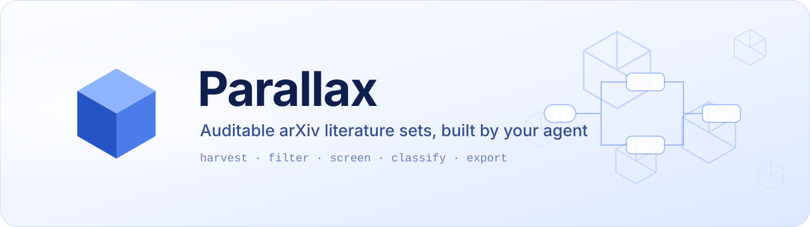
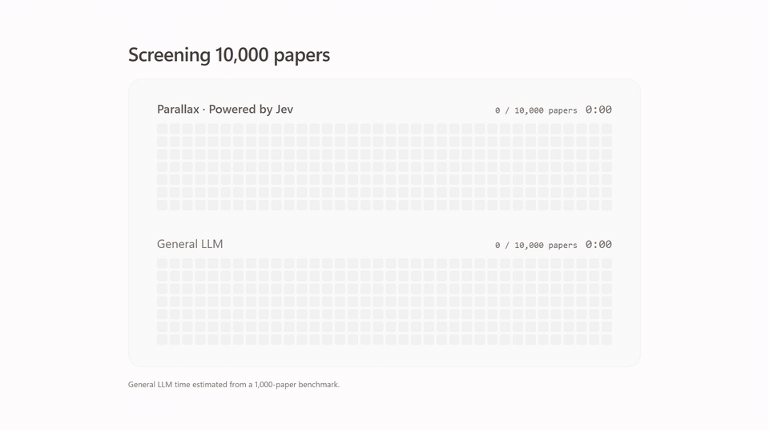

<div align="center">

<a href="https://parallax.ink"></a>

<h3>Comprehensive arXiv literature search for your agent, on a local corpus.</h3>

<p>
  
  
  
  
  
</p>

<p>
  <a href="https://parallax.ink"></a>
</p>

<p>
  <a href="#quick-start">Quick start</a> ·
  <a href="#usage">Usage</a> ·
  <a href="docs/development.md">Development</a>
</p>

<p><b>English</b> · <a href="README.zh-CN.md">简体中文</a></p>

</div>

---

**Parallax is a DeepSeek Harness (dsh) plugin for finding the arXiv papers on a topic from a local corpus.** It harvests arXiv metadata into SQLite. The agent then searches it with set operations (keyword recall, union, subtract, AI screening and classification), and each intermediate set shows up in the dsh sidebar, where you can open it.

<p align="center">
  
  <br>
  <sub>A typical graph: recall routes → merge → AI screening → AI classification. The semantic-search routes shown here are from Parallax online; this plugin recalls by keyword.</sub>
</p>

A general-purpose agent searches the open web through a black-box search API: it sees only the top-k results, can't tell you how many papers a topic really has, and spends effort cleaning up noise. Parallax works the other way round. The agent recalls exhaustively from a corpus with known boundaries, keeps every intermediate result as a set you can inspect, and leaves per-paper judgement to Jev, a judge model that returns calibrated probabilities rather than free-text verdicts.

- **Local arXiv corpus**: harvest the categories you care about day by day, with a coverage calendar that shows exactly which days are in.
- **Auditable set graph**: every step is an immutable node, so you can see what each one kept, what it dropped, and why.
- **AI screening and classification**: Jev judges thousands of papers in minutes, trialled on a sample first, and never pays twice for the same paper.
- **A research skill included**: a literature-search playbook for reading lists, surveys, method and trend searches, loaded only when needed.

The corpus, the graphs and every judgement stay in a SQLite file on your machine.

## How it works

Searching papers is not like ranking a feed, and a recall → coarse filter → fine filter funnel isn't enough:

- **It needs several recall routes.** A topic goes by several names, each name becomes one keyword route, and the routes have to be merged and deduplicated.
- **It needs review and repair.** Human or agent, the first pass misses things. Review has to be able to drop false positives in bulk and add back what was missed.

Merging, deduplicating and removing are set operations. So in Parallax the unit the agent works with is a **set of papers**, and every set is an immutable node in a graph:

- **Corpus root**: a virtual starting point (a category scope or date range of the local corpus), so the whole library never has to be materialized as a set.
- **Rule filter**: filters by arXiv category, submission date, or keywords in title, abstract or authors (substring or whole-word).
- **Named list**: arXiv ids listed by hand, for papers you already know or ones the review found missing.
- **Union / subtract**: merges recall routes, and removes false positives.
- **AI screening**: the agent turns your intent into inclusion and exclusion criteria, and Jev gives each paper a probability of inclusion (kept at p ≥ 0.5 by default).
- **AI classification**: splits a screened set into 2–12 classes, single-label or multi-label (a paper can belong to two classes).

Screening is where a plain LLM gets slow and expensive: it has to write a verdict for every paper, and long batches of structured output break easily. Jev answers typed questions with probabilities directly, so it is both faster and cheaper:

<p align="center">
  
  <br>
  <sub>Screening 10,000 papers: about 2 minutes with Jev versus about 20 with a general LLM (LLM time estimated from a 1,000-paper benchmark).</sub>
</p>

The graph is drawn live in the **Build graph** tab of the right sidebar. Click any node to see which papers it kept, which it excluded, and the probability behind each judgement.

Keeping sets in a database with indexes, rather than having the agent track them as text or JSON in the conversation, buys two things. It scales: a single Jev run takes up to 20,000 candidates. And it moves large, deterministic work into code, which holds up against model hallucination and against details lost when the context gets compacted. Because nodes are immutable, a change is always a new node, and the full chain of reasoning stays on the graph.

## Plugin or online?

This plugin is the local, open-source edition of Parallax. [Parallax online](https://parallax.ink) runs the same set-graph search with a larger corpus and more of the work around it:

| | This plugin | Parallax online |
|---|---|---|
| **Corpus** | The categories and days you harvest yourself | arXiv cs.* since 2020 (about 820k papers), ready to search |
| **Recall** | Keyword, category, date | Keyword, category, date, and semantic search |
| **Screening and classification** | Jev, with your own API key | Jev |
| **After the search** | Export the set as JSON | Reading view, field surveys, daily / weekly / monthly progress reports |
| **Where it runs** | Your machine, inside DeepSeek Harness | In the browser, nothing to install |

Pick the plugin if you want everything local or want to change how it works. If you just want to see what a Parallax search feels like, [sign up for Parallax online](https://parallax.ink) and try it there first.

## Quick start

> Just want to try it? [Parallax online](https://parallax.ink) needs no install or harvesting.

### Requirements

- DeepSeek Harness with a profile that includes the web UI (`@deepseek-ai/dsh-web-app`)
- Node.js ≥ 22.5 (the plugin uses the built-in `node:sqlite`, so there is no native module to compile)
- A Jev API key for AI screening and classification (optional: rule filters and set operations work without one)

### Build and install

```sh
git clone <repository-url> parallax-dsh
cd parallax-dsh
npm install
npm run build

dsh plugin --profile <profile> add ./parallax-dsh
dsh --profile <profile>
```

> A new profile starts with the base components only. If it has no web UI, run
> `dsh --profile <profile> --from-default-profile web` to reset it to the web template, then `add`.

### First-time setup

Open the dropdown next to the Parallax icon in the conversation header → **Settings**:

| Setting | What it does |
|---|---|
| **arXiv categories** | The harvest scope, e.g. `cs.CL`, `cs.AI`, or a whole group such as `cs.*`. The coverage calendar is measured against it. |
| **Jev judge model** | The API key is kept in the dsh credential file, never in the plugin database, and the browser never sees it. |
| **Network** | An HTTP proxy shared by harvests and Jev requests. Node's built-in `fetch` ignores `HTTPS_PROXY`, so on a network that needs a proxy, set it here, e.g. `http://127.0.0.1:7890`. |

The agent can set the categories and proxy for you. The API key can only be entered in Settings, so it never ends up in a conversation transcript.

## Usage

### A typical search

Type `/parallax-skills` in the composer (or pick **Literature retrieval** from the `+` menu), then ask your question as usual:

```
/parallax-skills What's new on planning for LLM agents in the first half of October? I'd like a short reading list.
```

The agent will roughly:

1. Check which dates the local corpus covers, and offer to harvest the missing ones; harvest progress shows live in the **Ingest** tab.
2. Run a few free probes to see how papers are distributed, then build one keyword route per name of the topic and merge them into a candidate set.
3. Write inclusion and exclusion criteria, try them on a small sample first to check the borderline calls, adjust, and then screen the whole set.
4. Read through the borderline keeps and exclusions, then ask whether you'd like the result grouped by AI classification (by method, task, and so on).
5. Answer from the abstracts it has actually read, and export JSON if you want a file.

You can watch the graph grow in the right sidebar the whole time. If a route looks wrong, tell the agent: it builds a new node to correct it rather than quietly rewriting the old one.

### Right sidebar

| Tab | What's there |
|---|---|
| **History** | One card per conversation that built sets; open one to see its graph |
| **Ingest** | A full-year coverage calendar (done / partial / not harvested), the harvest dialog and the job list |
| **Build graph** | The current conversation's graph: select a node to list its papers, use its info button for details and JSON export, or expand the graph |
| **Settings** | arXiv categories, the Jev judge model, and the network proxy |

### Tools for the agent

| Tool | Purpose |
|---|---|
| `parallax` | Read-only: corpus coverage, keyword search, full abstracts by id, and the research skill's documents |
| `parallax_set` | The set graph: probe, create nodes, trial, screen, classify, page through members, wait / resume / cancel, export |
| `parallax_ingest` | Harvesting: coverage, start / wait / cancel a harvest, job history, category scope and proxy |

Harvests and judging runs the agent starts are registered as dsh background jobs: the conversation header shows their progress with a stop button, and the agent is notified when they finish instead of having to wait on them.

The research skill ships with the plugin (`skills/parallax/`): a playbook plus guides split by scenario, covering reading lists, topic surveys, method searches, trend tracking, citation lineage and evidence for a decision. Only a one-line description stays in context; the playbook and guides load when they're needed.

### Export format

An export is the set's paper list, one item per paper:

```json
[
  {
    "id": "2610.20603",
    "title": "…",
    "authors": ["Xiaoli Xu", "Zhengtao Wu"],
    "published_at": "2026-10-14T17:59:48.000Z",
    "primary_category": "cs.CV",
    "categories": ["cs.CV"],
    "abstract": "…",
    "abs_url": "https://arxiv.org/abs/2610.20603v1",
    "pdf_url": "https://arxiv.org/pdf/2610.20603v1.pdf"
  }
]
```

## Data, cost and privacy

- **Your data stays local.** The corpus, graphs and judgements are in `$DSH_HOME/storages/parallax.db` (`~/.dsh` by default).
- **Only two hosts are contacted.** Harvests go to `oaipmh.arxiv.org`, at least 4 seconds apart as arXiv asks. AI screening and classification go to the Jev endpoint you configure, and send only each paper's title, abstract, authors, date and categories, plus your criteria.
- **Each judgement is paid for once.** Jev judgements are stored per paper; after a failure, a cancel or a restart, resuming only judges papers that have no judgement yet.
- **The key stays out of the database.** The dsh credential service holds the Jev API key; the `PARALLAX_JEV_API_KEY` environment variable works too.

## Limitations

- The corpus has arXiv **metadata and abstracts** only: no full text, no citation graph, no embeddings. Recall is by keyword, so the agent covers the different names of a concept with separate routes. Semantic recall is available in [Parallax online](https://parallax.ink).
- The local corpus holds only the dates and categories you harvested; it is not all of arXiv (Parallax online comes with cs.* since 2020). And arXiv's OAI interface serves records by **datestamp** (the date of the last metadata change), not by submission date: a revised paper moves to a later date. So the agent treats only an **unbroken run** of fully harvested days as complete coverage, and says so when gaps could change its answer.
- Jev returns probabilities, not reasons, and is billed per request. The skill has the agent run a trial before a full run, and read the abstracts of borderline papers itself.

## Development

```sh
npm run watch       # rebuild on change; the browser half hot-reloads
npm run typecheck   # type-check both halves
npm run smoke       # host-half smoke test (build first)
```

The plugin layout, how dsh plugins work, and the pitfalls I ran into are in the [development guide](docs/development.md) (in Chinese).

## License

[Apache License 2.0](LICENSE)
